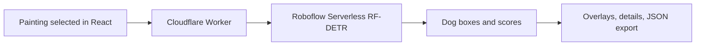

# Dogs in the Details

Find and inspect dogs in public-domain paintings with **Roboflow's hosted RF-DETR Medium**. Built for developers working on museum, library, and digital-collection interfaces.

**Demo:** https://dogs.zuchka.dev

The useful output is a location: a box and a close-up you can inspect, share, or export. These paintings already have dog-related catalog tags. This project does not claim to discover missing metadata or replace a curator's judgment.

## Run a prediction in one command

Requirements: Node.js **24 or later**, a Roboflow account with serverless inference access, and a private API key from [Roboflow API settings](https://app.roboflow.com/settings/api). Hosted inference uses your Roboflow credits.

Copy `.env.example` to `.dev.vars`, then edit that file locally to set your key. Do not paste a key into browser code, a public issue, or a recorded terminal.

```sh
cp .env.example .dev.vars
# Edit .dev.vars in your editor.
node --env-file=.dev.vars scripts/detect.mjs public/images/886.jpg --artwork-id 886
```

The standalone command needs no npm dependencies. To try your own JPEG or PNG, replace the image path and use any positive numeric `--artwork-id` as its output identifier. Images must be under 8 MB. Add `--output result.json` to save normalized dog boxes, or `--raw-output raw.json` to inspect every class returned by the model.

## Run the website locally

```sh
npm ci
npm run build
npm run preview
```

Open http://localhost:8787. The bundled paintings and saved predictions work without a key; **Find the dogs** makes a fresh hosted request and requires the key in `.dev.vars`.

For UI development, run `npm run dev:api` in one terminal and `npm run dev` in another. Vite proxies `/api` to the local Worker. Rebuild after changing artwork assets.

## What Roboflow does

The model is the COCO-pretrained **RF-DETR Medium object detector**, executed on **Roboflow Serverless**, a hosted Roboflow product. This is not a local model demo. No custom training was performed.

1. The browser selects a painting and posts its numeric ID to `/api/detect`.
2. A Cloudflare Worker reads that approved image from its static assets and sends the image bytes to Roboflow. The key stays on the server.
3. Roboflow predicts classes, confidence scores, and center-based pixel boxes.
4. The Worker keeps `dog` predictions and converts their boxes into fractions of the original image, measured from its top-left corner.
5. React draws those boxes and crops the same image. The slider filters the returned predictions locally; it does not run the model again.

This uses **object detection**, not segmentation. A crop is a rectangular view of the painting, not a pixel mask of the dog. Confidence is a model score, not a calibrated probability of correctness.



The HTTP endpoint is pinned to `coco/40`, the underlying version mapped from `rfdetr-medium` in Roboflow's SDK. See [integration notes](docs/roboflow-integration.md) for the verified request format and links.

## Saved results and limitations

Saved examples are actual hosted Roboflow responses generated during the build. Their model and timestamps are preserved, and the UI labels them **saved**. A live error stays an error; it does not silently become a saved result.

The model was pretrained on photographs, not this painting collection. Small dogs, dark interiors, stylized forms, partial occlusion, other animals, and duplicate low-confidence boxes are useful failure cases. A zero-result response means the model found nothing above the chosen threshold; it does not prove there is no dog. The eight hand-selected paintings are a small qualitative check, not an accuracy benchmark.

See [evaluation notes](docs/evaluation.md) and [artwork provenance](docs/artwork-notes.md). Public-domain status was checked for every bundled image using the [Art Institute of Chicago API](https://api.artic.edu/docs/). The museum does not endorse this project.

## Deploy your own copy

The app needs no database or GPU on Cloudflare. Roboflow runs the model remotely.

1. In `wrangler.jsonc`, remove this project's `account_id` and `routes`, and choose a unique Worker `name`. This deploys to your own `workers.dev` address. Add a custom domain from your own Cloudflare zone later.
2. Run `npx wrangler login` and authenticate with your Cloudflare account.
3. Run `npx wrangler secret put ROBOFLOW_API_KEY` and enter your key at the prompt.
4. Run `npm run deploy`.

The public demo limits live inference to six requests per IP per minute in each Cloudflare location. This is a usage guard, not a global spending cap. The server accepts only bundled artwork IDs. No visitor image uploads or authentication are implemented.

Use a dedicated, least-privilege inference key where your Roboflow plan supports scoped keys. Never commit `.dev.vars`. The supplied example contains no credentials.

## Project map and checks

| Path | Responsibility |
| --- | --- |
| `src/App.tsx`, `src/styles.css` | Collection UI, overlays, and crops |
| `worker/index.ts` | Input validation, hosted call, rate limit, errors |
| `worker/detections.ts` | Response validation and coordinate conversion |
| `scripts/detect.mjs` | Minimal local-image reproduction |
| `scripts/fetch-artworks.py` | Fetch public-domain Chicago images, sequentially |
| `public/results` | Genuine saved inference results |

```sh
npm test
npm run build
npx wrangler deploy --dry-run
```

Regenerate Cloudflare binding types with `npx wrangler types` after changing configuration. Refresh the artwork collection with `python3 scripts/fetch-artworks.py`; the fetcher uses the museum's recommended image width, an identifying User-Agent, and at least one second between requests.
