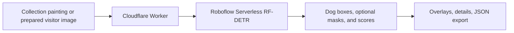

# Dogs in the Details

Find and inspect dogs in public-domain paintings with **Roboflow's hosted RF-DETR detection and segmentation models**. Built for developers working on museum, library, and digital-collection interfaces.

**[Try the demo](https://dogs.zuchka.dev)** · **[Source on GitHub](https://github.com/zuchka/dogs-in-the-details)** · **[Assessment deliverables](https://dogs.zuchka.dev/assessment)**

The useful output is a location: a box or an approximate dog outline, plus a close-up you can inspect, share, or export. Dog-related catalog titles and subject tags helped select the examples. This project does not claim to discover missing metadata or replace a curator's judgment.

The gallery contains **40 public-domain paintings**. Search by title or artist, or choose **Browse all** to open the full grid. Each work has genuine saved Roboflow results for both modes; **Find the dogs** runs fresh inference.

Choose **Boxes** for the original detector or **Outlines** for instance segmentation. These select different pretrained RF-DETR checkpoints, so their dogs and confidence scores can differ. Switching can reuse a saved or previously fetched result for that image and mode; **Find the dogs** always requests a fresh result. Boxes remains the default and the fallback if segmentation is unavailable.

## Try your own painting

Choose **Upload** or **Image URL** in the demo, preview your image, choose **Boxes** or **Outlines**, then click **Find the dogs**. The result uses the same overlays, detail crops, confidence slider, and JSON export as the museum examples.

- JPEG, PNG, and WebP files up to 8 MiB are supported. Original images must be under 40 megapixels and 16,384 pixels on either side.
- The browser applies image orientation, resizes the longest edge to at most 2,048 pixels, and creates a JPEG without the original metadata. This exact image is both displayed and sent for inference.
- Image URLs must be direct public HTTPS links. The image host must allow browser downloads through CORS, and redirects are rejected. If a host blocks imports, download the image and use Upload.
- Clicking **Find the dogs** sends the prepared image through our server to Roboflow. This app does not store visitor images in its gallery. They last for the current page session; custom-image links cannot be shared as saved results. Roboflow processes the image under its service policies.

Only submit images you have permission to process. No account is required for the public demo.

## Run a prediction in one command

Requirements: Node.js **24 or later**, a Roboflow account with serverless inference access, and a private API key from [Roboflow API settings](https://app.roboflow.com/settings/api). Hosted inference uses your Roboflow credits.

```sh
git clone https://github.com/zuchka/dogs-in-the-details.git
cd dogs-in-the-details
```

Copy `.env.example` to `.dev.vars`, then edit that file locally to set your key. Do not paste a key into browser code, a public issue, or a recorded terminal.

```sh
cp .env.example .dev.vars
# Edit .dev.vars in your editor.
node --env-file=.dev.vars scripts/detect.mjs public/images/886.jpg --artwork-id 886
```

The standalone command needs no npm dependencies. To try your own JPEG or PNG, replace the image path and use any positive numeric `--artwork-id` as its output identifier. Images must be under 8 MB. Add `--output result.json` to save the normalized predictions, or `--raw-output raw.json` to inspect every class returned by the model.

For dog outlines, select the segmentation checkpoint:

```sh
node --env-file=.dev.vars scripts/detect.mjs public/images/886.jpg \
  --artwork-id 886 --mode segmentation
```

Omitting `--mode` preserves the original box detector. Segmentation predictions retain their boxes and add normalized polygon `points`.

## Run the website locally

```sh
npm ci
npm run build
npm run preview
```

Open http://localhost:8787. The bundled paintings and saved predictions work without a key; **Find the dogs** makes a fresh hosted request and requires the key in `.dev.vars`.

For UI development, run `npm run dev:api` in one terminal and `npm run dev` in another. Vite proxies `/api` to the local Worker. Rebuild after changing artwork assets.

## What Roboflow does

Both modes run COCO-pretrained **RF-DETR** checkpoints on **Roboflow Serverless**, a hosted Roboflow product. Boxes uses RF-DETR Medium; Outlines uses RF-DETR Seg Medium. Both recognize COCO's 80 object categories, without a text prompt or custom training for these paintings.

1. For a collection painting, the browser posts its numeric ID to `/api/detect`. For a visitor image, it posts the prepared image bytes to `/api/detect-upload`.
2. A Cloudflare Worker validates the request, enforces the shared rate limit, and sends the image bytes to Roboflow. The key stays on the server. Image URLs are imported by the browser; our server never fetches a visitor-supplied URL.
3. Roboflow predicts classes, confidence scores, and center-based pixel boxes. The segmentation checkpoint also returns polygon points describing each predicted instance's mask.
4. The Worker keeps `dog` predictions and converts boxes and any polygon points into fractions of the returned image dimensions, measured from its top-left corner.
5. React draws the boxes or mask polygons and crops the same image. The slider filters the returned predictions locally; it does not run the model again.

**Object detection** locates a dog with a rectangle. **Instance segmentation** also estimates its silhouette. The outline is approximate, and a convincing mask can still belong to a misclassified animal. Detail crops remain rectangular in both modes. Confidence is a model score, not a calibrated probability of correctness.



The HTTP endpoints are pinned to `coco/40` for `rfdetr-medium` and `coco-dataset-vdnr1/37` for `rfdetr-seg-medium`, using the mappings in Roboflow's SDK. See [integration notes](docs/roboflow-integration.md) for the request format and links.

## Saved results and limitations

Saved examples are actual hosted Roboflow responses generated during the build. Their model and timestamps are preserved, and the UI labels them **saved**. A live error stays an error; it does not silently become a saved result.

The model was pretrained on photographs, not this painting collection. Small dogs, dark interiors, stylized forms, partial occlusion, other animals, and duplicate low-confidence boxes are useful failure cases. A zero-result response means the model found nothing above the chosen threshold; it does not prove there is no dog. The 40 hand-selected paintings are an exploratory gallery, not an accuracy benchmark. The original eight-image pilot retains its separate qualitative evaluation.

See the original [detection evaluation](docs/evaluation.md), the separate [segmentation spot-check](docs/segmentation-evaluation.md), and [artwork provenance](docs/artwork-notes.md). Public-domain status was checked for every bundled image using the [Art Institute of Chicago API](https://api.artic.edu/docs/). The museum does not endorse this project.

## Deploy your own copy

The app needs no database or GPU on Cloudflare. Roboflow runs the model remotely.

1. In `wrangler.jsonc`, remove this project's `account_id` and `routes`, and choose a unique Worker `name`. This deploys to your own `workers.dev` address. Add a custom domain from your own Cloudflare zone later.
2. Run `npx wrangler login` and authenticate with your Cloudflare account.
3. Run `npx wrangler secret put ROBOFLOW_API_KEY` and enter your key at the prompt.
4. Run `npm run deploy`.

The public demo shares a limit of six live inference requests per IP per minute across collection and visitor images in each Cloudflare location. This is a usage guard, not a global spending cap. Uploads are bounded and independently checked on the server. There is no database, visitor gallery, or authentication.

Use a dedicated, least-privilege inference key where your Roboflow plan supports scoped keys. Never commit `.dev.vars`. The supplied example contains no credentials.

## Assessment page and walkthrough recording

[`/assessment`](https://dogs.zuchka.dev/assessment) brings together the demo, source code, walkthrough, and launch note. Its 176-word note is imported directly from `docs/launch-note.md`; edit that file to update both the repository and page.

The [original walkthrough MP4](https://dogs-media.zuchka.dev/walkthrough-2026-10-16.mp4) is hosted in the dedicated Cloudflare R2 bucket `dogs-in-the-details-media`. It is 219,830,000 bytes, with H.264 video, AAC audio, and fast-start metadata. Its 6:08 duration exceeds the assessment's requested under-five-minute limit. The recording is preserved at its original speed and quality.

To replace it, upload a browser-compatible MP4 using a new object name, set `src` in `src/assessment-video.ts` to its public HTTPS URL, then rebuild and deploy. The player provides native playback, seeking, volume, and fullscreen controls without autoplay. An optional `captionsSrc` accepts an English WebVTT file; the script link is available alongside the player. Verify playback and seeking on the live page after upload.

The video stays outside Git and the Worker deployment because it exceeds Cloudflare's [25 MiB static-asset limit](https://developers.cloudflare.com/changelog/post/2025-09-02-increased-static-asset-limits/). R2 serves it directly through `dogs-media.zuchka.dev`; watching the recording makes no Roboflow inference calls.

## Project map and checks

| Path | Responsibility |
| --- | --- |
| `src/App.tsx`, `src/styles.css` | Collection UI, overlays, and crops |
| `src/Assessment.tsx`, `src/assessment-video.ts` | Assessment page and walkthrough video configuration |
| `src/ImageImport.tsx`, `src/image-input.ts` | Upload/URL preview, size checks, orientation, and resizing |
| `worker/index.ts` | Input validation, hosted call, rate limit, errors |
| `worker/detections.ts` | Response validation and coordinate conversion |
| `scripts/detect.mjs` | Minimal local-image reproduction |
| `scripts/fetch-artworks.py` | Fetch public-domain Chicago images, sequentially |
| `scripts/discover-artworks.py` | Search public-domain paintings by dog-related titles and subject tags |
| `public/results`, `public/results-segmentation` | Genuine saved results, kept separately by checkpoint |

```sh
npm test
npm run build
npx wrangler deploy --dry-run
python3 scripts/check-secrets.py
```

Regenerate Cloudflare binding types with `npx wrangler types` after changing configuration. Refresh the artwork collection with `python3 scripts/fetch-artworks.py`; the fetcher uses the museum's recommended image width, an identifying User-Agent, and at least one second between requests.

Find more catalog candidates with `python3 scripts/discover-artworks.py`. Catalog matches are candidates for visual inspection, not model detections. To generate saved results for newly added paintings, run `node --env-file=.dev.vars scripts/generate-results.mjs --run-missing`; this makes one paid hosted inference request per missing captured response and reuses existing responses.

Generate the separate outline results with `node --env-file=.dev.vars scripts/generate-results.mjs --mode segmentation --run-missing`. Original box fixtures remain in `public/results`; outline fixtures go to `public/results-segmentation`.
